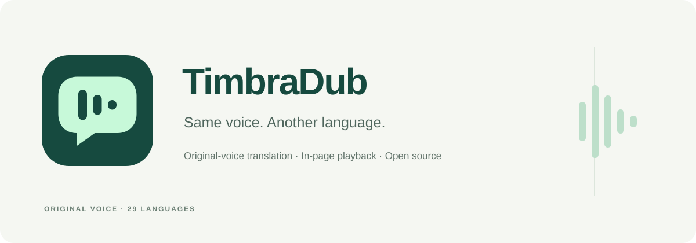

# 听译 · TimbraDub

[English](README.md) · **简体中文**



[下载插件安装包](https://github.com/lvyinchao/timbradub/releases/latest) · [使用与反馈](https://github.com/lvyinchao/timbradub/issues) · [隐私说明](PRIVACY.md)

MIT 开源项目。Chrome 商店 v0.2.2 已撤回，v0.2.3 正在准备，上传及提交尚未完成；尚未确认获批或在商店公开。GitHub 安装包是独立分发渠道。详见[商店状态](docs/store/STATUS.md)。

**用原声的音色，听另一种语言。** 在原网页播放器上播放跟随视频时间轴的译音和双语字幕，无需自建后端。

**使用前需要用户自行前往 [qianwenai.com](https://qianwenai.com/) 注册账号并申请自己的 API Key。** 在插件设置中填写 API Key、Workspace ID 和对应地域，模型费用由用户自己的账号按实际用量结算。项目不提供公共密钥或免费模型额度。

> 当前为功能预览版：Bilibili 已有英语→中文、中文→英语、日语→中文的真实播放记录；持续 1.5 倍速下仍有明显缓冲和译音截尾，尤其中文→英语，起播误差达标不代表完整语句都能播完。YouTube 可读取部分片段，但长视频后续音轨遇到播放验证限制，尚未通过连续译音验收。样本、比例及完整边界见[兼容性与验收记录](docs/VALIDATION.md)。

## 安装

1. 从 [Releases](https://github.com/lvyinchao/timbradub/releases/latest) 下载 `timbradub-<版本>-chrome.zip` 并完整解压，保留完整文件夹。
2. 打开 Chrome 的 `chrome://extensions`，打开右上角“开发者模式”。
3. 点击“加载已解压的扩展程序”，选择**直接包含 `manifest.json` 的解压文件夹**。自 v0.2.2 起无需再进入 `extension` 子目录；v0.2.1 及更早的包仍需选择内部的 `extension`。
4. 将“听译”固定在工具栏，刷新已打开的视频页面。
5. 自行前往 [qianwenai.com](https://qianwenai.com/) 注册账号并申请 API Key，然后在侧边栏设置中填写 API Key、Workspace ID 和对应地域，保存后验证连接。

遇到“清单文件缺失或不可读取”时，按[中文安装说明和目录树](docs/INSTALL.zh-CN.md)检查所选文件夹。`-chrome.zip` 用于本地安装，`-webstore.zip` 用于开发者后台上传，`-source.zip` 用于源码开发，三者不能混淆；不要直接拖入 ZIP 安装。安装后保留解压目录。

安装时会提示访问网站。Chrome 对请求头修改同时检查目的地址和发起方；真实验证表明，窄域名声明不足以给扩展自身的 WebSocket 握手添加鉴权头，因此使用 `<all_urls>` 主机权限。媒体观察仅针对侧边栏所选标签页或当前翻译任务；侧边栏使用 15 秒可续期租约，关闭面板或切到无关标签后停止对应观察，正在翻译的标签可继续观察。已发现媒体地址与请求头上下文有效期为 60 秒，过期后在后续扫描或后台启动时清理，不保存完整浏览历史。内容脚本可检测普通 HTTP/HTTPS 网页及 iframe 中的播放器；媒体探测覆盖公开 HTTPS CDN 的文件、HLS、DASH 和分片；鉴权规则仅作用于扩展自身访问指定的百炼模型地址，不会给视频网站附加模型密钥。

## 使用

**用原声的音色，听另一种语言。** 保留原说话人的音色特征，跟随原视频时间轴播放译音和双语字幕。

推荐使用已实测的 [Bilibili 示例视频](https://www.bilibili.com/video/BV13rsaeaEgE/)：先播放几秒，选择中文并开始翻译；准备好后可在播放中切换日语。示例展示使用方法，音色相似度依模型和音源而定。

界面支持 English / 简体中文，首次打开默认为英文；通过侧边栏右上角的语言选择器即时切换，选择会自动保存在本机。面板内品牌标题、页面标题、“原声音色”标语和工具栏悬停提示都随界面语言切换。Chrome 扩展管理页名称及浏览器自带的侧栏外框标题由浏览器语言决定，插件设置无法即时改名。界面语言与“翻译成”的视频目标语言独立，视频目标语言仍默认中文。移除 API 凭据不会重置语言偏好。

打开普通点播视频，先播放几秒，让扩展识别音轨。在侧边栏选择视频和目标语言，点击“开始翻译”。扩展会暂停原视频，1 倍速先准备约 30 秒源视频时间的译音，1.5 倍速约 45 秒、2 倍速约 60 秒，再自动继续播放；此后持续准备后续内容，准备量上限 90 秒。模型输入保守按 1 倍速发送，倍速观看时仍可能再次缓冲。实际等待取决于网络和模型，不能用官方同传延迟当作首次准备时间。

- 翻译中可随时更改“翻译成”，从当前画面位置切换译音和字幕；已缓存的新语言直接恢复，没有缓存则暂停准备后再继续。暂停时切换会保持暂停，音量、倍速和字幕开关不变。连续选择多个语言，以最后一次为准。
- 原视频默认静音。可分别调整原声和译音音量；降低原声也会降低原片中的音乐。
- 0.2.3 的“显示原语言字幕”“显示目标语言字幕”可独立开关：只显示原文、只显示译文、同时显示或全部关闭。新会话默认双开，关闭字幕不影响译音播放。
- 暂停、恢复、跳转和 0.5～2 倍速跟随原播放器；已验证播放器容器全屏，原生 video 元素全屏及画中画字幕尚不支持。
- 数据尚未就绪时暂停缓冲。长译音最多以 2 倍速度播放，仍赶不上时跳过过期部分，保持画面连续，字幕保留完整译文。
- “停止翻译”恢复开始前的原声音量和静音设置。
- 设置页分别显示播放缓存、归档暂存和音轨临时空间，并提供独立清理入口；请先停止翻译再清理。默认播放缓存上限 128 MiB。清理归档暂存不会删除已下载的文件，本机凭据另有移除入口。

模型为 `qwen3.8-livetranslate-flash-realtime`。只发送音轨，不发送整段视频或画面。默认启用 Qwen 的实时音色复刻，随原说话人生成译音。模型复刻完成前可能使用默认音色过渡，不能承诺音色完全一致。扩展会校验服务端是否确认启用音色复刻；未确认则停止并提示。原音色缓存与系统音色缓存隔离。配置依据：[百炼客户端事件文档](https://help.aliyun.com/en/model-studio/live-translator-client-events)。

API Key 不放入网页、Chrome 同步存储、源码或发行包。译音和字幕会缓存在这台浏览器的 IndexedDB 中，费用由百炼账户结算。

## 全部 29 种译音目标语言

中文、英语、日语、韩语、法语、德语、西班牙语、葡萄牙语、俄语、阿拉伯语、意大利语、印度尼西亚语、泰语、越南语、土耳其语、印地语、马来语、荷兰语、乌尔都语、挪威语（书面语）、瑞典语、丹麦语、希伯来语、芬兰语、波兰语、冰岛语、捷克语、菲律宾语、波斯语。

详见[中英文语言及代码对照表](docs/LANGUAGES.md)。这些是支持语音输出的目标语言；所有目标语言均请求保留原说话人音色，实际相似度依模型和音源而定。

## 视频网站与音轨读取

0.1.4 开始，除 YouTube / Bilibili 专用适配器外，加入优酷、爱奇艺、腾讯视频等网站的通用检测：扫描当前页、iframe 和开放 Shadow DOM 的视频，并观察实际媒体请求。可匹配的完整媒体文件和未加密 HLS 点播可交给解码器提前读取；未找到播放器时仍列出已发现的媒体请求并标记暂不可翻译；多个资源无法确定归属时明确提示，不把其他播放器或广告音轨直接配给当前视频。通用检测不等于这些网站所有影片均已通过翻译验收。

0.1.6 已移除兼容播放器及标签页录制权限，使用原网页播放器。侧边栏打开期间，每 3 秒检查当前页面，并响应媒体请求和页面切换，找到可用音轨后自动更新列表；检测过程不调用翻译模型。安装更新后，已打开的视频页面需要刷新一次，让新版媒体观察脚本生效。

0.1.7 修复 YouTube 清晰度切换时的重复检测：一个观看页面仅选择当前主播放器，排除隐藏旧播放器、预览画面及嵌入的重复播放器；切换分辨率只更新同一视频条目的尺寸。克隆元素不再沿用原播放器 ID。真实 YouTube 720p→1080p→720p 切换测试保持一个相同标识的控制目标；播放器元素被替换时停止旧控制，避免操作错误对象。

当前 3.8 实时模型要求音频输入，可选画面帧不能代替声音。含音频的 MP4、WebM 或 HLS 资源可在扩展内解封装、提取音频并保留源时间戳，无需先取得独立音频文件；纯视频分片仍需对应音频数据。当前接口不直接上传 MP4 文件给模型。参见[客户端输入事件](https://help.aliyun.com/zh/model-studio/live-translator-client-events)。

腾讯视频增加原生 HLS 观察：读取播放器已解析的明文点播列表，并关联到实际 video 元素，避免混入广告或其他播放器的资源；旧版明文播放信息仍可解析。不解密受保护内容。指定的《兰香如故》第 5 集已在约 19:40 处暂停、提前读取后续 30 秒、生成英文译音并恢复原网页播放，两次首次准备实测约 34～42 秒；不代表所有清晰度、登录状态或影片均已通过验收。

针对“需要 1180 秒、却只取得约 5 秒”的报错，主视频有分片时不再把旁边孤立的 MP4 自动当成完整音轨；翻译前也会检查文件音轨是否明显短于视频。正常 MP4/HLS 的该中段窗口已通过读取测试；不能用给短文件强加时间偏移的方式掩盖资源错误。

DASH 清单、独立分片和带 MediaKeys 的受保护播放器会显示发现状态及具体限制。当前没有通用 DASH 清单解析，也没有 DRM 解密路径。只有取得可提前读取的音轨后才可翻译；特殊播放器和闭合 Shadow DOM 仍可能需要站点适配。

对于忽略 HTTP Range、始终返回整份文件的服务器，0.1.4 把已读原始媒体字节暂存至扩展的临时本地文件，供解码器回读，内存缓存保持 8 MiB。后续窗口复用该响应；工作线程退出后，下次创建临时媒体文件时回收遗留文件。单份兼容音轨上限 2 GiB，每个解码线程最多同时保留两份；退出或切换解码线程时旧新文件可能短暂并存，不是全扩展最多两份的硬上限，空间不足、数据不完整和超时均会报错。停止翻译后也可在设置页手动清理音轨临时空间。此类服务器可能要求顺序读完整份音轨才能开始，准备时间取决于文件大小与网络。这些临时文件与永久译音分段分开，不弹下载窗口。

“显示原语言字幕”和“显示目标语言字幕”分别控制原文及译文，点击立即生效；后续片段、容器全屏及翻译目标语言切换保持当前组合。

## 保存到本地

侧边栏底部“本地保存”区域提供“自动保存翻译文件”开关，**默认关闭**，旧版本升级且尚无此偏好的用户同样默认关闭。开关即时生效并记住选择，不需要填写模型凭据才能切换。

关闭时不把新译音暂存为归档文件，不自动合并或发起下载；原网页翻译播放和用于跳转的播放缓存照常工作。此前已保存的片段和下载文件会保留，仍可手动“合并并保存”。关闭也会拦下尚未发起下载的自动合并；已交给 Chrome 的下载可能继续完成。

开启后，译音先静默分段保存在扩展的本机专用文件目录（OPFS）。分段不会发起下载，也不打开保存位置选择器；跳转和重开侧边栏同样不会启动下载。此前 0.1.2 的待保存队列会迁移到本机分段目录，已下载的旧文件保留。

开启自动保存时，翻译完成、停止或失败退出会按视频、目标语言与音色把已完成的语句合并，只下载一个最终 ZIP 到 Chrome 设置的下载目录下 `TimbraDub/` 文件夹。也可在侧边栏点击“合并并保存”。相同内容不重复下载；合并中断后保留片段，用户点击重试时才重新下载。重开扩展不会反复重试已取消的保存。

每个合并包包含可连续播放的 `combined.wav`、与该音频时间对应的 `combined.srt`、使用原视频时间的 `source-subtitles.srt`，以及双语 `transcript.txt` / `transcript.json`。WAV 按源视频顺序拼接完整的 24 kHz 原音色语句，不变速、不截尾，不拼接 WAV 文件头。句间空白和未翻译的源视频区间不放入合并音频，JSON 同时记录源视频时间和合并音频时间；未完成整段视频不会标为已完成。

片段保存在本机专用目录中，合并 WAV 和 ZIP 也按流写盘，不把整段长视频音频一次性装入 JavaScript 内存。播放缓存的 128 MiB 上限不再限制归档片段；归档使用浏览器允许的本地磁盘空间，空间不足会明确报错。清除播放缓存或 API 凭据不会删除已暂存片段和已下载文件；设置页提供独立的归档暂存清理入口。卸载扩展或清除此扩展全部站点数据会移除其内部片段，已下载的文件仍由你管理。

保存过程使用[浏览器专用本机文件系统](https://web.dev/articles/origin-private-file-system)，不更改 Chrome 全局下载设置，不关闭浏览器的安全检查，不上传到额外服务，也不包含密钥、签名媒体地址或请求头。如果 Chrome 开启了“下载前询问每个文件的保存位置”，最终合并包仍会询问一次；分段阶段不询问。系统或浏览器对最终文件的必要安全提示仍由 Chrome 控制。

## 范围

首版面向桌面 Chrome 116 及以上版本、普通点播、可预取的独立音轨。直播、DRM、音乐人声分离、独立声音复刻管理、原视频下载导出和移动端未包含。网页和 CDN 可能变化；无法获取可预取音轨时明确报错，不会自动降级成明显滞后的“边听边译”。

同步指语句与媒体时间轴关联，不承诺逐字口型同步。真实验收状态请以随包的验收记录为准，构建通过不等于站点或长视频测试通过。

## 开发与验证

需要 Node.js 22.12 或更高版本；ZIP 交付与归档测试使用系统的 `zip` / `unzip` / `tar`（macOS 自带），媒体浏览器门禁还需要 FFmpeg。单元、离线浏览器和发行包测试使用自有合成夹具，无需模型账号。

```sh
npm ci
npm run check
npm test
npm run build
npx playwright install chromium
HEADLESS=1 npm run test:browser
npm run package
npm run verify:release
npm run test:release
```

CI 和标签发布使用同一个验证工作流，全部离线浏览器门禁成功后才能发布。`test:release` 通过 Chrome 实际下载 ZIP，解压并加载安装包根目录，再从独立源码 ZIP 运行 `npm ci`、类型/单元检查、构建和全部离线浏览器门禁。许可检查会自动比对已安装 Mediabunny 版本、锁文件 SHA-512 和随包对应源码；发行包还检查清单、图标、目录和常见密钥模式。这些测试不代替真实网站和长时译音验收。

[0.2.2 审查修复记录](docs/REVIEW-2026-10-16.md)逐项列出问题、修复及回归入口，并单独说明真实验收边界。

发行冒烟验证回执在运行完成后生成，作为 CI/发行的独立附件提供，不打入源码 ZIP；回执中的哈希对应它实际验证的安装包和源码包。

构建目录为 `.output/chrome-mv3`。可加载该目录调试；仓库中的 `work/` 为研究与隔离测试材料，不进入发行包。

浏览器验收脚本使用 Playwright 的独立配置目录及 Chrome for Testing，不修改常用 Chrome 的配置。脚本通过浏览器根 CDP 会话加载扩展；生产扩展不使用 `debugger` 权限或调试协议。`gate-browser.mjs` 当前从本机百炼 CLI 配置读取测试凭据，仅适用于本机验收，不会把该配置复制进发行包。

## 依赖与许可

本扩展为独立实现，没有复制 FetchV 的代码。使用 WXT、React、Lucide、Mediabunny 和固定版本的 googlevideo。YouTube SABR 音轨读取基于 googlevideo；Bilibili 使用播放器实际请求的独立音轨。Mediabunny 1.61.4 使用 MPL-2.0，保留其许可及来源说明；见发行包 `THIRD_PARTY_NOTICES.md`。安装包不从第三方网站动态加载执行脚本。
