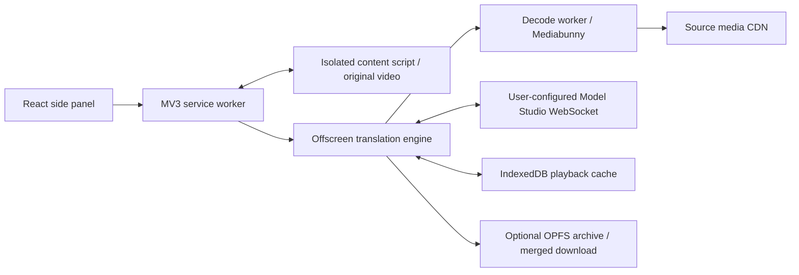

# Architecture

## Data flow

The service worker discovers video identities, associates sources, validates message origins and coordinates a single playback session. YouTube and Bilibili have native metadata/request adapters; generic discovery observes files, clear HLS, DASH and fragments without claiming all are decodable. A Tencent page-world bridge observes narrowly scoped, already-parsed clear HLS metadata. It is not a DRM-decryption mechanism.

Media observation is scoped to tabs selected by a visible panel or used by the active task, rather than every browsing tab. Panel leases renew for 15 seconds; discovered source URLs and request-header context are valid for 60 seconds, then removed on a subsequent scan or background startup. A sleeping MV3 worker does not guarantee immediate physical deletion at that deadline. Closing a panel or switching away releases its observation, while a translation task retains its own tab.

The offscreen engine reads ahead while the video is paused. A worker demuxes/decode audio, retaining media timestamps, and resamples it to mono 16 kHz PCM. The realtime adapter sends continuous audio windows to `qwen3.8-livetranslate-flash-realtime`, collects sentence-aligned source/translated text and 24 kHz output, sends `session.finish`, and waits for `session.finished`. Original-voice cloning is requested; lack of provider confirmation fails the task.

## Timeline and cancellation

`HTMLVideoElement.currentTime` is the master clock. Source sample positions map into media time, then model utterances, then translated audio. Output is not played according to network arrival time. Segments start at source sentence times, use pitch-preserving speed adjustment up to an absolute 2×, and skip expired tails rather than accumulate delay. Missing preparation pauses the video. Initial source-time preparation is 30 seconds at 1×, 45 at 1.5× and 60 at 2×, capped by the remaining duration. Preparation is bounded by a 90-second lookahead. Because source input is conservatively sent at 1×, increased video speed may still exhaust prepared audio and rebuffer.

Session ID, seek epoch and language version reject obsolete work at background, engine and player boundaries. A language change immediately clears old speech/captions while preserving the player control object and original-audio restoration snapshot. Cached target-language ranges are reused; uncached ranges prepare from the actual current video position. Rapid language switches, concurrent seeks and stop are exercised by an isolated browser gate.

## Storage

- Restricted Chrome local storage: credentials and preferences. Not synced.
- Chrome session storage: restorable active-session and source bookkeeping.
- IndexedDB: bounded LRU translated playback cache (128 MiB default), keyed by media identity, source audio track, target language and voice mode.
- OPFS: optional per-utterance archives and streaming merge scratch files; separately, temporary source bytes for servers ignoring Range. The latter has a two-source limit per decoder and a 2 GiB-per-source limit; old/new decoders can overlap briefly during retirement, so two sources is not a hard extension-wide limit.
- Downloads: explicit or enabled automatic final ZIPs. Intermediate utterance staging does not trigger download prompts.

Settings expose playback cache, archive staging and temporary source media separately, with explicit clearing while translation is stopped. Clearing one area does not imply deletion of the others; downloaded files remain under the user’s file manager.

## Permissions

| Permission                            | Why it exists                                                                                                                  |
| ------------------------------------- | ------------------------------------------------------------------------------------------------------------------------------ |
| `sidePanel`                           | Display the extension controls                                                                                                 |
| `storage`                             | Store credentials/preferences/task state with trusted-context access restrictions                                              |
| `activeTab`, `tabs`                   | Identify the active page, coordinate video identity and lifecycle                                                              |
| `scripting`                           | Inspect player metadata and controllable videos in frames                                                                      |
| `webRequest`                          | Observe relevant audio/media requests and associate their identity                                                             |
| `<all_urls>` host access              | Inspect user-selected sites/frames, prefetch CDN audio, and meet Chrome's origin checks for extension-origin auth header rules |
| `declarativeNetRequestWithHostAccess` | Temporarily add allowlisted model auth and origin/referrer media headers; never attach the model key to a website request      |
| `offscreen`                           | Run background audio/media processing under MV3                                                                                |
| `downloads`                           | Save a final merged archive when enabled or explicitly requested                                                               |

The current build requests no microphone, camera, tabCapture, debugger, or history API permission. Host access is broad; runtime operations and auth destinations are constrained in code. The [privacy policy](../PRIVACY.md) describes processing and retention.

## Packaging boundary

Dependencies are locked by `package-lock.json`; the pinned googlevideo source archive is kept in `vendor/`. The untouched Mediabunny npm source archive is included in release distributions to supply the corresponding MPL source. Icons are rendered deterministically from the editable SVG using resvg. No remote executable code is loaded by the extension. Model/provider credentials are never part of a build.

Installation ZIPs from v0.2.2 have `manifest.json` at the root, while the stable local packaging directory remains `outputs/extension`. A reusable validation workflow is shared by main/PR CI and tag releases. Publication consumes its exact artifacts after type/unit checks, all offline browser gates, license/source-integrity checks and download/extract/install plus clean-source reproduction. The source ZIP includes original generated audio fixtures and excludes historical third-party voice recordings. These checks verify software and distribution behavior, not model quality or real-site acceptance.
